# Data model

The entities the server keeps in DuckDB, how they relate, and which of them still need a decision. The columns of each table are in `data-map.md`, which is the source of truth for names and units; this page shows the shape and the relations. It describes the schema at version 7 (`DuckDbSchemaAdapter`).

The schema has no foreign keys. A relation below is **logical**: the two sides carry the same key values, and a query joins them on those columns.

## The current shape

```mermaid
erDiagram
    assets ||--o| asset_identifiers : "market, ticker, asset_type"
    assets ||--o| company_registry : "market, ticker, asset_type"
    assets ||--o{ quotes : "market, ticker, asset_type"
    assets ||--o{ dividends : "market, ticker, asset_type"
    assets ||--o{ splits : "market, ticker, asset_type"
    assets ||--o{ fundamentals : "market, ticker, asset_type"
    assets ||--o{ financial_statements : "market, ticker, asset_type"
    assets ||--o{ fii_monthly : "market, ticker, asset_type"
    assets ||--o{ filings : "market, ticker, asset_type"
    assets ||--o{ company_disclosures : "market, ticker, asset_type"
    filings ||--o{ chunks : "filing_id"
    asset_identifiers }o--o| fund_registry : "legal_id = cnpj (FII)"
    fund_registry ||--o{ fund_daily : "cnpj"
    fund_registry ||--o{ fund_holdings : "cnpj"

    assets {
        VARCHAR market PK
        VARCHAR ticker PK
        VARCHAR asset_type PK
        VARCHAR legal_id
        VARCHAR name
        VARCHAR sector
        VARCHAR currency
    }
    asset_identifiers {
        VARCHAR market PK
        VARCHAR ticker PK
        VARCHAR asset_type PK
        VARCHAR legal_id
        VARCHAR isin
        VARCHAR company_name
    }
    company_registry {
        VARCHAR market PK
        VARCHAR ticker PK
        VARCHAR asset_type PK
        VARCHAR legal_id
        VARCHAR company_name
        VARCHAR sector
        VARCHAR situation
    }
    quotes {
        VARCHAR market PK
        VARCHAR ticker PK
        DATE date PK
        DOUBLE close
        DOUBLE volume
    }
    dividends {
        VARCHAR market PK
        VARCHAR ticker PK
        DATE ex_date PK
        VARCHAR kind PK
        DOUBLE amount
    }
    splits {
        VARCHAR market
        VARCHAR ticker
        DATE date
        DOUBLE ratio
    }
    fundamentals {
        VARCHAR market PK
        VARCHAR ticker PK
        INTEGER year PK
        VARCHAR metric PK
        DOUBLE value
    }
    financial_statements {
        VARCHAR market
        VARCHAR ticker
        DATE period_end
        VARCHAR statement
        VARCHAR line_item
        DOUBLE value
        INTEGER version
    }
    fii_monthly {
        VARCHAR market PK
        VARCHAR ticker PK
        DATE period PK
        DOUBLE net_worth
        INTEGER version
    }
    filings {
        VARCHAR filing_id PK
        VARCHAR market
        VARCHAR ticker
        VARCHAR filing_type
        DATE reference_date
        VARCHAR url
    }
    chunks {
        VARCHAR filing_id PK
        INTEGER seq PK
        VARCHAR text
    }
    company_disclosures {
        VARCHAR market
        VARCHAR ticker
        VARCHAR dataset
        VARCHAR section
        DATE reference_date
        VARCHAR row_json
    }
    fund_registry {
        VARCHAR cnpj PK
        VARCHAR fund_name
        VARCHAR administrator
        DOUBLE net_worth
    }
    fund_daily {
        VARCHAR cnpj PK
        DATE date PK
        DOUBLE quota
        DOUBLE net_worth
    }
    fund_holdings {
        VARCHAR cnpj
        DATE period
        VARCHAR block
        DOUBLE market_value
    }
    macro_series {
        VARCHAR series PK
        DATE date PK
        DOUBLE value
    }
    treasury_prices {
        VARCHAR bond_type PK
        DATE maturity PK
        DATE base_date PK
        DOUBLE sell_rate
    }
    market_expectations {
        VARCHAR indicator PK
        INTEGER reference_year PK
        DATE survey_date PK
        INTEGER calculation_base PK
        DOUBLE median_value
    }
    fx_rates {
        VARCHAR currency PK
        DATE date PK
        DOUBLE sell_rate
    }
    cache_runs {
        VARCHAR run_id PK
        VARCHAR category
        VARCHAR market
        VARCHAR ticker
    }
    cvm_files {
        VARCHAR url PK
        VARCHAR sha256 PK
        VARCHAR dataset
    }
```

The four series tables (`macro_series`, `treasury_prices`, `market_expectations`, `fx_rates`) have no relation to an asset: a series is identified by its own key (the series code, the bond family, the indicator, the currency). The control tables (`cache_runs`, `cvm_files`) describe loads, not data, and have no relation to the data tables.

## Keys by kind

| Kind | Tables | Key |
| --- | --- | --- |
| Asset | `assets`, `asset_identifiers`, `company_registry`, `quotes`, `dividends`, `splits`, `fundamentals`, `financial_statements`, `fii_monthly`, `filings`, `company_disclosures` | `market, ticker, asset_type` (plus the time column where the table has one) |
| Document text | `chunks` | `filing_id, seq` |
| Fund | `fund_registry`, `fund_daily`, `fund_holdings` | `cnpj` (the fund class CNPJ) |
| Series | `macro_series`, `treasury_prices`, `market_expectations`, `fx_rates` | the series key (`series`, `bond_type`, `indicator`, `currency`) |
| Control | `cache_runs`, `cvm_files`, `schema_version` | the load or the file |

A query must filter these keys (`docs/product/data-map.md`, "Filters"). The market of a series is an internal name in the registry (`SERIES`, `TDIR`, `FOCUS`, `FX`, `FUND`), not a market of the B3.

## Decisions pending (proposal)

These points come from reviewing the shape above. None of them is implemented. Each one needs an answer before the code changes.

1. **One key convention.** Assets use `(market, ticker, asset_type)`; series and funds use a single column of their own, and the registry markets (`SERIES`, `TDIR`, `FOCUS`, `FX`, `FUND`) are invented. Option: keep both and document the reason, or give series and funds a common `entity` column.
2. **One company identity.** The CNPJ and the name of a company are in `assets` (Yahoo), `asset_identifiers` (B3) and `company_registry` (CVM). Option: a single `companies` entity, with each source filling its own columns and a `source` per column group.
3. **`fii_monthly` is wide.** Most of its value columns come from one source and are null for the rest. Option: a long table (`period, metric, value`), as `fundamentals` already is.
4. **FII has no fund data.** `fund_registry`, `fund_daily` and `fund_holdings` come from CVM's fund files, which do not cover FII. A FII has its CNPJ (from B3) but no daily quota or holdings. Option: accept the gap, or find another source per FII.
5. **No position entity.** The analysis of a portfolio needs the holdings (asset, quantity, average price, date). There is no table for it. Option: a `positions` table that the user fills, joined to the asset keys above.
6. **Tables without a primary key.** `splits`, `financial_statements`, `fund_holdings` and `company_disclosures` are not keyed, so a reload relies on the replacement rule alone. Option: key them, and keep the row order and version in the key.
7. **Mixed sources in one column.** `quotes.adj_close` comes from yfinance or Yahoo and is null from B3. Option: a `price_source` per row, or one quotes table per source.

## Where the rules live

- Names, units and the filter rule of each table: `docs/product/data-map.md`.
- What a provider fills, and how a new source is added: `docs/product/architecture.md` and `docs/product/adding-a-source.md`.
- Why a choice was made: `docs/adr/`.
