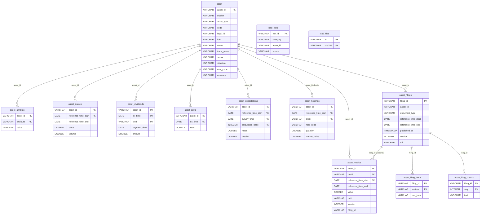

# Data model

The entities the server keeps in DuckDB, how they relate, and the rules behind their names. The columns and units of each table are in `data-map.md`; the rules that produce this shape are in `docs/data-modelling-standards.md`.

The store is at schema version 9, which is this model. The older names are listed in `data-map.md` under migration.

The schema has no foreign keys. A relation is **logical**: both sides carry the same `asset_id`, and a query joins them on it.

## Entities



## What each entity holds

| Entity | Holds | Key |
| --- | --- | --- |
| `asset` | One row per asset: its identity and the fields every asset may have (CNPJ, ISIN, name, sector, situation). | `asset_id` |
| `asset_attribute` | Descriptors that only some types have (administrator and manager of a fund, class). | `asset_id, attribute` |
| `asset_quotes` | Daily prices and volume of a stock or a FII. | `asset_id, reference_time_start` |
| `asset_dividends` | Proventos, with the ex date and the payment date. | `asset_id, ex_time, kind` |
| `asset_splits` | Stock splits and reverse splits. | `asset_id, ex_time` |
| `asset_metrics` | Every number observed over time: fundamentals, FII monthly values, statement lines, fund quota, Treasury prices and rates, macro indexes, currency rates. | `asset_id, metric, reference_time_start` |
| `asset_expectations` | Market expectations of a macro indicator, by survey. | `asset_id, reference_time_start, survey_time, calculation_base` |
| `asset_holdings` | What a fund holds, by block, with quantity and value. | `asset_id, reference_time_start, block` |
| `asset_filings` | One row per document: ITR, DFP, FRE, IPE and the other CVM and FNET documents. | `filing_id` |
| `asset_filing_items` | Rows of a document that have no single number (FRE, VLMO, CGVN), as JSON. | `filing_id, section` |
| `asset_filing_chunks` | Text of a document, for search. | `filing_id, seq` |
| `load_runs` | Each load: its category, its asset, its source, its time and its error. | `run_id` |
| `load_files` | Each CVM file downloaded, with its hash. | `url, sha256` |

## Asset identifiers

| Asset | `asset_id` |
| --- | --- |
| Stock | `BR:stock:PETR4` |
| FII | `BR:fii:HGLG11` |
| Investment fund | `BR:fund:00.017.024/0001-53` |
| Treasury bond | `BR:treasury:TESOURO_SELIC_2027-03-01`, the family and the maturity (`data-map.md` has the rule) |
| Macro index | `BR:index:IPCA` |
| Tax rate | `BR:tax_rate:SELIC` |
| Currency rate | `BR:currency:USD` |

## Queries

A query names the assets it reads by `asset_id`. Each asset table in a query needs its own filter; a join does not pass the filter of one table to the other:

```sql
SELECT reference_time_start, close
FROM asset_quotes
WHERE asset_id = 'BR:stock:PETR4' AND reference_time_start >= DATE '2026-01-01'
```

```sql
SELECT a.name, q.reference_time_start, q.close
FROM asset a JOIN asset_quotes q USING (asset_id)
WHERE a.asset_id = 'BR:stock:PETR4' AND q.asset_id = 'BR:stock:PETR4' AND q.reference_time_start >= DATE '2026-01-01' 
```

A filter on another column, such as the sector, does not name the assets to load, so it is refused. A query on `asset_metrics` also names the metrics it reads, with `metric = ` or `IN`.

## Open points

1. **Scope of a load.** A load writes one asset, the one its requirement names, and replaces the rows of that asset in its scope (for `asset_metrics`, the metric group of its category). A row for another asset or another period is refused.
2. **Treasury codes.** A bond is named by its family and its maturity. The rule for characters that are not in the code alphabet is in `data-map.md`.
3. **Migration.** Done in schema 9; the mapping of the older names is in `data-map.md`.
